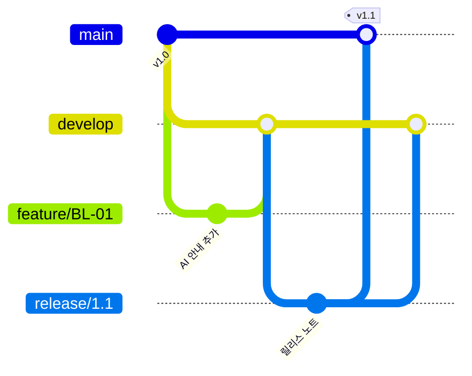

# Git Flow (5교시)

모든 작업을 GitHub 웹 화면에서 합니다. 명령어는 쓰지 않습니다.

## 브랜치 역할

| 브랜치 | 역할 | 어디서 만드나 | 어디로 병합하나 |
| --- | --- | --- | --- |
| `main` | 운영 중인 버전 | - | - |
| `develop` | 다음 버전을 모으는 곳 | `main` | `release` 로 이어짐 |
| `feature/*` | 이슈 하나의 작업 | `develop` | `develop` |
| `release/*` | 릴리스 준비 | `develop` | `main`, `develop` |
| `hotfix/*` | 운영 중 긴급 수정 | `main` | `main`, `develop` |



## 1. `develop` 만들기 (팀장, 1회)

1. 저장소 **Code(코드)** 탭의 브랜치 선택 버튼을 누릅니다.
2. `develop` 을 입력하고 **Create branch: develop from main** 을 누릅니다.

## 2. 브랜치 보호 규칙 (팀장, 1회)

1. **Settings(설정) → Branches(브랜치)** 로 이동합니다.
2. `main` 과 `develop` 에 각각 규칙을 추가합니다.
3. **Require a pull request before merging(병합 전 PR 필수)** 을 켜고 승인 수를 1로 정합니다.

자기가 올린 PR은 자기가 승인할 수 없습니다. 리뷰어가 꼭 필요합니다.

## 3. `feature` 브랜치에서 작업하기

1. 브랜치 선택에서 `develop` 을 고릅니다.
2. `feature/BL-01-ai-notice` 처럼 이슈 번호를 넣어 새 브랜치를 만듭니다.
3. 수정할 파일을 열고 연필 아이콘 **Edit this file(파일 편집)** 을 누릅니다.
4. 수정 후 **Commit changes(변경 사항 커밋)** 를 누릅니다. 이 브랜치에 바로 커밋합니다.

## 커밋 메시지

이슈 번호와 바뀐 내용을 적습니다.

```text
BL-01 대상 결과 화면에 AI 판정 안내 추가
```

## 릴리스하기 (7교시)

1. `develop` 에서 `release/1.1` 브랜치를 만듭니다.
2. `CHANGELOG.md` 를 정리해 커밋합니다.
3. `release/1.1` → `main` PR을 만들고 승인 후 병합합니다.
4. `release/1.1` → `develop` PR도 만들어 병합합니다.
5. **Releases(릴리스) → Draft a new release(새 릴리스 작성)** 에서 태그 `v1.1` 을 만들고, 대상은 `main` 으로 합니다.

병합할 때는 **Create a merge commit(병합 커밋 만들기)** 을 고릅니다.

## 긴급 수정하기 (hotfix)

1. `main` 에서 `hotfix/1.0.1` 브랜치를 만듭니다.
2. 수정하고 커밋합니다.
3. `hotfix/1.0.1` → `main` PR을 만들어 병합합니다.
4. `hotfix/1.0.1` → `develop` PR도 만들어 병합합니다.

4번을 빠뜨리면 다음 릴리스에서 같은 결함이 되살아납니다. 두 병합이 끝날 때까지 브랜치를 지우지 마세요.

## 병합 충돌이 났을 때

1. PR 화면의 **Resolve conflicts(충돌 해결)** 를 누릅니다.
2. `<<<<<<<`, `=======`, `>>>>>>>` 표시 사이의 내용을 보고 남길 문장을 정합니다.
3. 표시 줄을 모두 지우고 **Mark as resolved(해결 표시)** → **Commit merge(병합 커밋)** 를 누릅니다.

브랜치 보호 때문에 이 화면에서 커밋할 수 없으면 강사를 불러 주세요.
