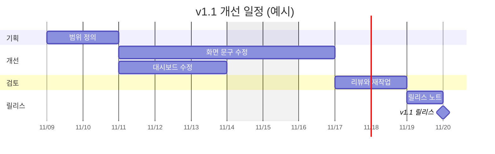

# 일정 양식 (4교시)

WBS의 작업에 시작일, 기간, 선행 작업을 붙여 Gantt Chart를 만듭니다. Jira의 **Timeline(타임라인)** 에도 같은 일정을 넣습니다.

## 일정표

스프린트는 가상으로 2주(2026-11-09~11-20), 평일 10일입니다.

| 작업 | 시작일 | 기간 | 선행 작업 | 담당 | 마일스톤 |
| --- | --- | --- | --- | --- | --- |
| | | | | | |

## Gantt Chart 예시

아래 코드 블록을 GitHub에서 보면 그림으로 표시됩니다. 날짜와 작업 이름만 바꿔 쓸 수 있습니다.

## 확인 질문

- 이 작업이 하루 늦어지면 릴리스도 늦어지나요? 그런 작업이 이어진 경로가 주경로입니다.
- 리뷰와 재작업 시간을 넣었나요?
- 한 사람에게 같은 날짜의 일이 몰려 있지 않나요?
